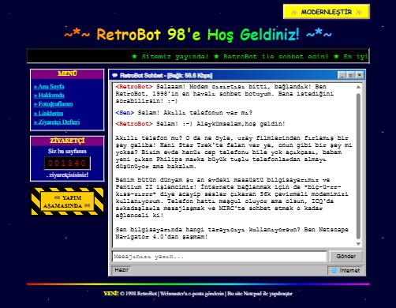
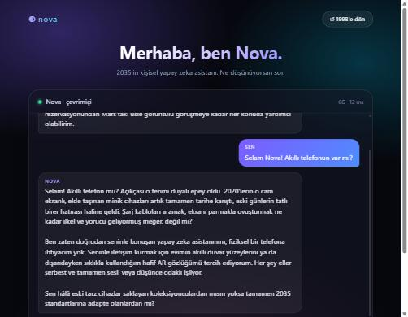

# RetroChatbot 📟 → 🚀

Kendini **1998 yılında** sanan bir sohbet botu. Tek bir butona basınca **2035 yılında** yaşayan modern bir yapay zeka asistanına dönüşüyor; arayüz de onunla birlikte değişiyor.

Python, FastAPI ve Google Gemini API ile yazılmış, eğitim amaçlı bir projedir. Arayüz hiçbir framework kullanmadan düz HTML, CSS ve JavaScript ile hazırlandı.

| 1998 · RetroBot | 2035 · Nova |
|:---:|:---:|
|  |  |

## Özellikler

- **RetroBot (1998):** Çevirmeli modemden, ICQ'dan, Windows 98'den bahseder. Akıllı telefon gibi 1998'den sonra çıkan bir şey sorulursa şaşırır ve bunun bilim kurgu gibi geldiğini söyler.
- **Nova (2035):** 2020'leri "eski günler" olarak anar; AR gözlüklerden, hava taksilerinden, Mars üssünden sıradan şeylermiş gibi bahseder.
- **İki farklı arayüz:**
  - 1998: Yıldızlı arka plan, kayan yazı, ziyaretçi sayacı, "Yapım aşamasında" tabelası ve Windows 98 tarzı pencere.
  - 2035: Koyu cam efekti, mesaj baloncukları ve akıcı geçişler.
- **Sohbet hafızası:** Bot aynı sohbet içindeki önceki mesajları hatırlar (son 20 mesaj).
- **Dayanıklılık:** Gemini yoğun olduğunda (503 gibi hatalarda) istek önce tekrar denenir, olmazsa yedek modellere geçilir.
- **Seçilen dönem korunur:** Sayfa yenilense de en son seçilen dönemde kalınır.

## Kullanılan teknolojiler

| Katman | Teknoloji |
|---|---|
| Backend | Python, FastAPI, Uvicorn |
| Yapay zeka | Google Gemini API (`google-genai`) |
| Frontend | HTML, CSS, JavaScript (framework yok) |

## Proje yapısı

```
RetroChatbot/
├── backend/
│   ├── main.py            # FastAPI uygulaması: /api/chat ve arayüz dosyalarını sunar
│   ├── gemini_client.py   # Gemini bağlantısı, iki botun kişiliği, tekrar deneme mantığı
│   ├── requirements.txt   # Python bağımlılıkları
│   └── .env.example       # Ortam değişkenleri için örnek dosya
├── frontend/
│   ├── index.html         # Sayfa yapısı (iki dönemin öğeleri)
│   ├── style.css          # 1998 ve 2035 temaları
│   └── script.js          # Sohbet ve dönem değiştirme mantığı
└── docs/                  # README ekran görüntüleri
```

## Kurulum

### 1. Projeyi indir

```bash
git clone https://github.com/oykualeyna/RetroChatbot.git
cd RetroChatbot
```

### 2. Sanal ortam oluştur ve bağımlılıkları kur

**Windows:**

```bash
python -m venv .venv
.venv\Scripts\activate
pip install -r backend/requirements.txt
```

**macOS / Linux:**

```bash
python3 -m venv .venv
source .venv/bin/activate
pip install -r backend/requirements.txt
```

### 3. Gemini API anahtarını ayarla

1. [Google AI Studio](https://aistudio.google.com/apikey) üzerinden ücretsiz bir API anahtarı al.
2. `backend/.env.example` dosyasını kopyalayıp adını `backend/.env` yap.
3. `GEMINI_API_KEY=` satırına kendi anahtarını yaz:

```env
GEMINI_API_KEY=senin-anahtarin
```

> ⚠️ **`.env` dosyasını asla GitHub'a yükleme.** Bu dosya `.gitignore` içinde tanımlı olduğu için Git onu zaten görmezden gelir. Anahtarın yanlışlıkla bir yere sızarsa Google AI Studio'dan hemen iptal edip yenisini oluştur.

### 4. Sunucuyu başlat

Proje kök klasöründeyken:

```bash
uvicorn main:app --reload --app-dir backend
```

Tarayıcıda **http://127.0.0.1:8000** adresini aç.

## Ayarlar

`backend/.env` içinde şu değişkenler kullanılabilir:

| Değişken | Zorunlu mu? | Varsayılan | Açıklama |
|---|---|---|---|
| `GEMINI_API_KEY` | Evet | — | Google AI Studio'dan alınan API anahtarı |
| `GEMINI_MODEL` | Hayır | `gemini-3.5-flash` | Kullanılacak ana model |
| `GEMINI_FALLBACK_MODELS` | Hayır | `gemini-3.5-flash-lite,gemini-3.6-flash` | Ana model yoğunken sırayla denenecek yedek modeller (virgülle ayrılır) |

## Nasıl çalışıyor?

1. Kullanıcı mesaj yazınca `script.js`, sohbet geçmişini ve seçili dönemi (`"1998"` ya da `"2035"`) `POST /api/chat` adresine gönderir.
2. `main.py` isteği doğrular ve `gemini_client.py` içindeki `ask_gemini()` fonksiyonunu çağırır.
3. `ask_gemini()`, döneme göre doğru kişilik metnini (sistem talimatı) seçer ve geçmişle birlikte Gemini'ye gönderir.
4. Gemini'nin cevabı JSON olarak arayüze döner ve sohbet penceresine eklenir.

İki dönem arasındaki görsel fark tamamen CSS ile sağlanır: Butona basıldığında `<body>` etiketine `modern` sınıfı eklenir. `retro-only` ve `modern-only` sınıflı öğeler buna göre gösterilir ya da gizlenir.

## API

**`POST /api/chat`**

İstek:

```json
{
  "era": "1998",
  "messages": [
    { "role": "user", "content": "Selam! Hangi yıldayız?" }
  ]
}
```

Cevap:

```json
{
  "reply": "Selam dostum! Tabii ki 1998 yılındayız! ..."
}
```

FastAPI'nin otomatik dokümantasyonu sunucu çalışırken **http://127.0.0.1:8000/docs** adresinde görülebilir.
